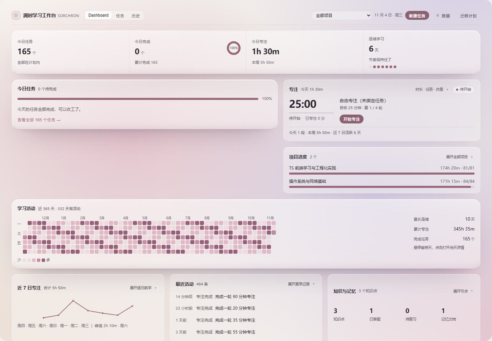
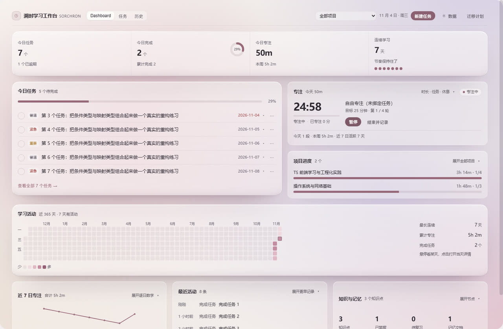
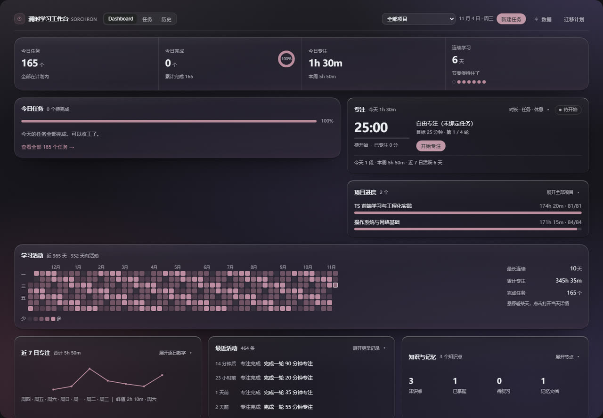
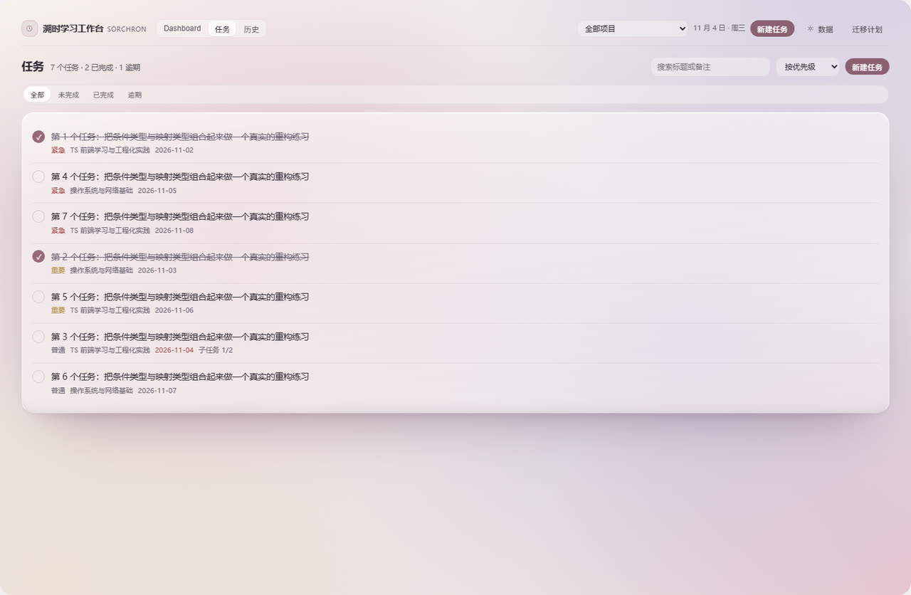

# Sorchron Study Board · 溯时学习工作台

**English** | [中文](./README.zh.md)

A DSH (DeepSeek Harness) plugin that adds one left-nav panel for solo study and coding:
a dashboard, a task list, a pomodoro focus timer with crash-safe settlement, Harness session
capture, a 365-day activity heatmap and JSON backup/restore. All records stay in the browser's
`localStorage`; the plugin makes no network requests.

`4.0.0-rc.1` · MIT · no account, no telemetry, no network calls

---

## ✨ Features

The panel has four pages: **Dashboard**, **Tasks**, **History** and **Settings** (opened from the
top bar as “Data” / 数据). Everything below is implemented and reachable from the UI — there are no
placeholder buttons.

| Area | What it actually does |
| --- | --- |
| **Dashboard** | Four summary metrics (tasks, completed, focus time, streak), today's tasks with inline check-off, a focus card, per-project progress, a 365-day activity heatmap, a 7-day trend, recent activity, and read-only knowledge/memory overview |
| **Tasks** | Create, edit, complete, reopen, two-step delete, search, sort, status filter, inline expand, and a detail drawer |
| **Focus timer** | Timestamp-based countdown (not a drifting `setInterval`), pause/resume, short and long breaks, task binding, explicit “finish and record” settlement, retry when a write fails, and idempotent accounting across refreshes and multiple tabs |
| **Session capture** | Mounted once at the workspace root; consumes DSH session events and counts **sessions only** — it never adds to focus minutes |
| **History** | 30 / 90 / 365-day heatmap with five intensity levels (same component and same aggregation as the dashboard), active days, per-day timeline, streak |
| **Backup / restore** | Export full / last 7 days / current month, import with preview, merge or overwrite, transactional rollback, real storage probe, two-step clear |
| **Settings** | Data overview, session-capture toggle, storage status, export, import, danger zone, capability boundaries |

### What “crash-safe settlement” means

Finishing a focus round writes four entities — the log, the daily aggregate, the task totals and the
timeline event — inside **one** transaction. If the transaction fails, the round is kept in a
pending state with a persisted baseline; the plugin then verifies all four entities before deciding
whether it may repair, retry, or refuse to touch anything.

The UI has three distinct outcomes and never claims more than it knows:

- **Saved** — all four entities verified.
- **Not saved** (red) — the write failed, the round is kept and can be retried.
- **Discarded** (neutral) — only shown after a discard was *proven* safe to perform.

Discarding is deliberately refused when the daily aggregate or the task totals have already been
counted for the round, because those two structures carry no round id — subtracting would guess and
could delete someone else's numbers. See [`KNOWN-LIMITATIONS.md`](./KNOWN-LIMITATIONS.md).

## 📦 Installation

### From GitHub (works today)

```bash
dsh plugin --profile desktop add github:SorenLorn/dsh-otaku-study-board
```

`lib/index.js` and `lib/client.js` are committed, so nothing is built on your machine. Reload the
DSH window afterwards and the panel appears in the left navigation as **溯时学习工作台**
(clock icon, order 20).

> `dsh plugin add dsh-otaku-study-board` (the short form) only works once the package is published
> to npm. It is not published yet, so use the `github:` form above.

### From a local clone (for development)

```bash
# 1. build
npm install
npm run build                      # → lib/index.js + lib/client.js

# 2. register it in your profile (use your own profile name)
dsh plugin --profile desktop add "file:/absolute/path/to/dsh-otaku-study-board"

# 3. reload the DSH window, then confirm
dsh plugin --profile desktop list
```

A symlink works too: if `node_modules/dsh-otaku-study-board` inside the profile points at your
clone, re-running `npm run build` is enough — no reinstall needed.

## 🚀 Usage

1. **Run one focus round** — Dashboard → focus card → “开始专注” (25 min by default; 10–90 min in the
   expanded settings). Pause any time, then press “结束并记录”.
2. **Record a task** — Tasks → “新建” → type a title → tick it in the list.
3. **See the feedback** — today's cell in the dashboard heatmap changes colour; hover for the
   day's numbers, click to open that day.
4. **Back up once** — top bar → “数据” → Export JSON. The data lives only in this browser profile.

A worked example of what one session produces:

```
09:30  start a 25-minute focus round, bound to task "Chapter 3 exercises"
09:55  finish → 1 focus log (25 min) + daily aggregate +25 + task +25 min / +1 pomodoro
09:56  tick the task → status completed, completedAt recorded
       dashboard: focus 25m · tasks 1 · heatmap score = 25 + 25×1 = 50 → level 2
```

Every button is documented in [`USER-GUIDE.md`](./USER-GUIDE.md).

## ⚙️ Configuration

There is **no config file** — the host half is intentionally a no-op and the plugin registers itself
from the client bundle. All runtime options live in the **Settings (数据)** page and are persisted in
`localStorage`:

| Option | Default | Notes |
| --- | --- | --- |
| Focus duration | 25 min | 10–90 min, per round |
| Short break | 5 min | 1–30 min |
| Long break | 15 min | 1–30 min |
| Rounds before a long break | 4 | drives the cycle indicator |
| Session capture | on | counts DSH sessions; off stops new captures |
| Active project scope | all projects | archived projects are excluded either way |

Data is stored under 14 keys prefixed `dsh-otaku-study-board:`, each wrapped in
`{ schemaVersion: 4, data }`. The `timer` key is transient and `aiRuns` is an audit key — neither is
included in backups. Older V1/V2/V3 data is read in place and upgraded on read without writing back.

## 🖼️ Screenshots

| Dashboard (light) | Focus timer |
| --- | --- |
|  |  |

| Dashboard (dark) | Tasks |
| --- | --- |
|  |  |

Captured from a standalone Chromium at 1440 px with real components and the real stylesheet; the
numbers are demo data. The plugin market reads [`screenshots.json`](./screenshots.json) for the same
images — see [`assets/README.md`](./assets/README.md) for how to add or replace them.

## 🛠️ Development

```bash
npm run typecheck     # tsc --noEmit — must be 0 errors
npm run build         # writes lib/index.js + lib/client.js
npm run clean         # removes lib/
```

Stack: React 18 function components + hooks, TypeScript 5.6 (`strict`), esbuild 0.25 producing two
artifacts with no bundler config file, cordis as the DSH plugin runtime, and a hand-written
`.v4-*` CSS namespace. Tests are plain scripts (no jest / vitest) — jsdom for component tests and a
standalone Chromium over CDP for browser tests. The most-used single command:

```bash
npx esbuild scripts/smoke.ts --bundle --platform=node --format=cjs --outfile=smoke.cjs && node smoke.cjs
```

Full commands, suite list and uncovered areas are in [`TESTING.md`](./TESTING.md). Design
constraints — host API findings, why the settlement transaction looks the way it does, storage
semantics — are in [`ARCHITECTURE.md`](./ARCHITECTURE.md).

## 🗑️ Uninstall

```bash
dsh plugin --profile desktop remove dsh-otaku-study-board
```

If the profile's `package.json` still lists `dsh-otaku-study-board` under `dsh.profile.bundles`,
delete that line too — otherwise the loader keeps looking for a package that is gone.

Reload the window; the left-nav entry disappears. Your data is **not** deleted by uninstalling —
remove it from the browser profile if you want a clean slate:

```js
// DevTools console of the DSH window
Object.keys(localStorage)
  .filter(k => k.startsWith('dsh-otaku-study-board:'))
  .forEach(k => localStorage.removeItem(k))
```

## 🤝 Contributing

Issues and pull requests are welcome. Before opening a PR:

- `npm run typecheck` and the test command above must pass.
- Keep the “never claim more than we know” rule: a failed write is reported as failed, an undecided
  state is reported as undecided, and no button may exist that does nothing.
- Business logic changes should come with a test; documentation-only changes do not need one.

See [`TESTING.md`](./TESTING.md) for how each suite is run and [`ARCHITECTURE.md`](./ARCHITECTURE.md)
for the invariants that must not be broken (settlement transaction, discard boundaries, heatmap
aggregation, focus state machine).

## 📄 License

MIT — see [`LICENSE`](./LICENSE).

## Further reading

| Document | Contents |
| --- | --- |
| [`USER-GUIDE.md`](./USER-GUIDE.md) | Every button, step by step, plus FAQ |
| [`ARCHITECTURE.md`](./ARCHITECTURE.md) | Current modules, data flow, consistency constraints |
| [`KNOWN-LIMITATIONS.md`](./KNOWN-LIMITATIONS.md) | Real limits and what is not implemented yet |
| [`TESTING.md`](./TESTING.md) | How to run the tests and what they cover |
