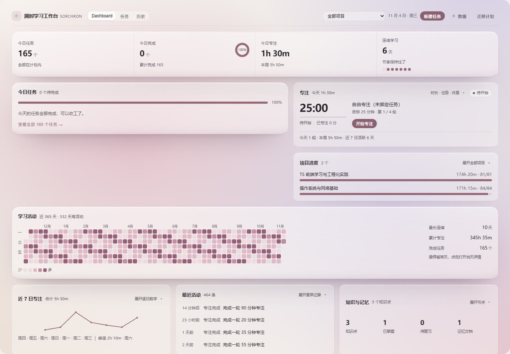
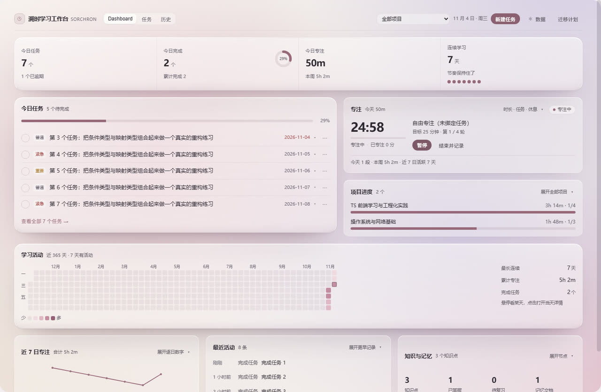
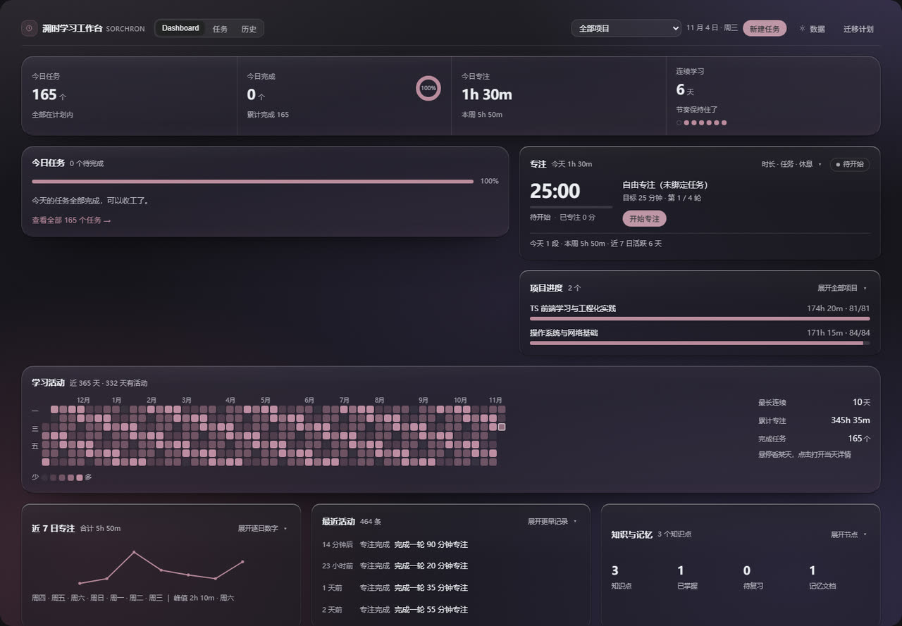
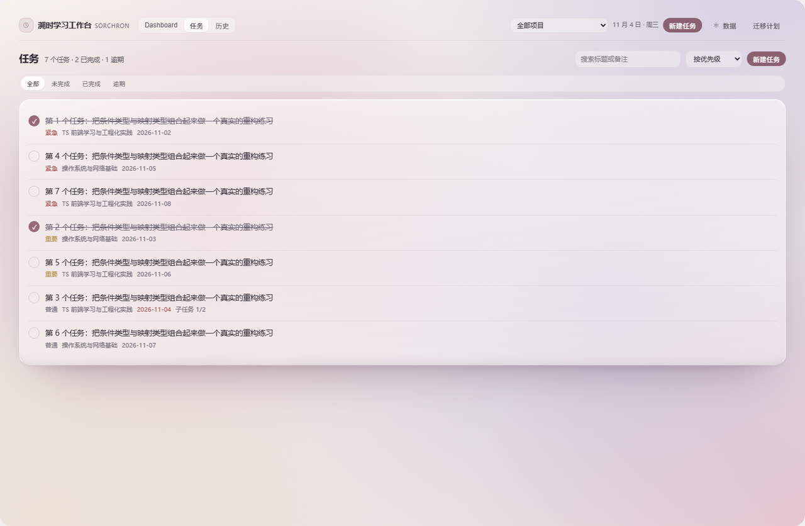

# Sorchron Study Board · 溯时学习工作台

[English](./README.md) | **中文**

一个 DSH（DeepSeek Harness）插件：在左侧导航里加一个面板，把「仪表盘 / 任务 / 番茄钟 /
会话采集 / 学习热力图 / 备份恢复」放进同一个工作台，面向长期自学与独立开发的人。
所有记录只写在浏览器 `localStorage`，插件不发起任何网络请求。

`4.0.0-rc.1` · MIT · 无账号、无遥测、不联网

---

## ✨ 功能特性

面板分四个页面：**仪表盘**、**任务**、**历史**、**设置**（顶栏「数据」进入）。
下面这些能力都已实装且能从界面点到，没有点了不反应的占位按钮。

| 区域 | 实际做了什么 |
| --- | --- |
| **仪表盘** | 四个汇总指标（任务 / 完成 / 专注 / 连续）、今日任务可直接勾选、专注卡、项目进度、365 天学习热力图、近 7 日趋势、最近活动、知识与记忆只读概览 |
| **任务** | 新建、编辑、完成、重开、两步确认删除、搜索、排序、状态筛选、行内展开、详情抽屉 |
| **专注计时** | 基于时间戳的倒计时（不是会漂移的 `setInterval`）、暂停继续、短休长休、绑定任务、「结束并记录」显式结算、写入失败可重试、刷新与多标签下不重复记账 |
| **会话采集** | 只挂在工作台根节点一次；接收 DSH 会话事件，只计**会话条数**，永远不进专注分钟 |
| **历史** | 30 / 90 / 365 天热力图（五档强度，与首页同一组件同一份聚合）、活跃天数、按天时间轴、连续天数 |
| **备份 / 恢复** | 全量 / 近 7 天 / 当月导出，导入前预览，合并或覆盖，事务回滚，真实存储探测，两步确认清空 |
| **设置** | 数据概览、会话采集开关、存储状态、导出、导入、危险区、能力边界 |

### 「崩溃安全结算」到底指什么

结束一轮专注要写四个实体——日志、日聚合、任务累计、时间轴事件——它们在同**一个**事务里写入。
事务失败时这一轮会带着持久化基线留在待结算状态，插件先校验四个实体，再决定能修复、能重试，
还是一律不动。

界面只有三种结论，且从不多说一个字的谎：

- **已记入** —— 四个实体全部校验通过。
- **未保存**（红色）—— 写入失败，这一轮被保留，可以重试。
- **已放弃**（中性）—— 只有**证明**清理是安全的之后才会出现。

日聚合或任务累计**已经算过这一轮**时，放弃会被刻意拒绝：这两个结构没有 roundId，扣减只能靠猜，
猜错就会扣掉别人的记录。详见 [`KNOWN-LIMITATIONS.md`](./KNOWN-LIMITATIONS.md)。

## 📦 安装

### 从 GitHub 安装（当前可用）

```bash
dsh plugin --profile desktop add github:SorenLorn/dsh-otaku-study-board
```

`lib/index.js` 与 `lib/client.js` 随仓库提供，本机不需要构建。装完重载 DSH 窗口，左侧导航出现
**溯时学习工作台**（时钟图标，order 20）。

> `dsh plugin add dsh-otaku-study-board` 这种短写法要等包发布到 npm 之后才可用。目前尚未发布，
> 请用上面的 `github:` 形式。

### 从本地克隆安装（开发者）

```bash
# 1. 构建
npm install
npm run build                      # → lib/index.js + lib/client.js

# 2. 装进 profile（profile 名按你自己的来）
dsh plugin --profile desktop add "file:/absolute/path/to/dsh-otaku-study-board"

# 3. 重载 DSH 窗口后确认
dsh plugin --profile desktop list
```

用符号链接也可以：如果 profile 里的 `node_modules/dsh-otaku-study-board` 指向你的克隆目录，
改完源码只需重新 `npm run build`，不必重装。

## 🚀 使用说明

1. **跑一轮专注** —— 仪表盘 → 专注卡 →「开始专注」（默认 25 分钟，展开设置可改 10–90 分钟）。
   中途可暂停，结束后点「结束并记录」。
2. **记一件事** —— 任务页 →「新建」→ 填标题 → 在列表里勾选完成。
3. **看反馈** —— 首页「学习活动」热力图当天格子会变色；悬停看当天数字，点格子打开当天详情。
4. **备份一次** —— 顶栏「数据」→ 导出 JSON。数据只在本浏览器里，换浏览器 / 清缓存会丢。

一轮会话产生的数据长这样：

```
09:30  开始 25 分钟专注，绑定任务「第三章 习题」
09:55  结束 → 1 条专注日志（25 分）+ 日聚合 +25 + 任务 +25 分 / +1 个番茄
09:56  勾选任务 → 状态变为已完成，记下完成时间
       仪表盘：专注 25m · 任务 1 · 热力图得分 = 25 + 25×1 = 50 → 第 2 档
```

每个按钮的完整说明见 [`USER-GUIDE.md`](./USER-GUIDE.md)。

## ⚙️ 配置说明

**没有配置文件** —— 宿主半是刻意 no-op，插件完全由客户端 bundle 自行注册。运行期选项都在
**设置（数据）**页，存在 `localStorage` 里：

| 选项 | 默认值 | 说明 |
| --- | --- | --- |
| 专注时长 | 25 分钟 | 10–90 分钟，按轮生效 |
| 短休 | 5 分钟 | 1–30 分钟 |
| 长休 | 15 分钟 | 1–30 分钟 |
| 几轮后长休 | 4 轮 | 决定轮次指示 |
| 会话采集 | 开 | 关掉后不再产生新的采集记录 |
| 项目作用域 | 全部项目 | 两种情况都排除已归档项目的数据 |

数据存在 14 个以 `dsh-otaku-study-board:` 为前缀的键里，写入信封 `{ schemaVersion: 4, data }`。
其中 `timer` 是瞬态键、`aiRuns` 是审计键，两者都不进备份。V1 / V2 / V3 的旧数据会就地读取并在
读时补齐，打开页面不写回。

## 🖼️ 截图说明

| 仪表盘（浅色） | 专注计时 |
| --- | --- |
|  |  |

| 深色主题 | 任务页 |
| --- | --- |
|  |  |

截图来自独立 Chromium（真实组件 + 真实样式，1440px），里面的数字是演示数据。插件市场通过
[`screenshots.json`](./screenshots.json) 读取同一批图片，增删与替换方式见
[`assets/README.md`](./assets/README.md)。

## 🛠️ 开发与构建

```bash
npm run typecheck     # tsc --noEmit，必须 0 错误
npm run build         # 产出 lib/index.js + lib/client.js
npm run clean         # 删掉 lib/
```

技术栈：React 18 函数组件 + hooks、TypeScript 5.6（`strict`）、esbuild 0.25（两个产物，无打包器
配置文件）、cordis 作为 DSH 插件运行时、手写 `.v4-*` 命名空间的 CSS。测试是纯脚本，没有
jest / vitest：组件用 jsdom，浏览器测试用独立 Chromium 走 CDP。最常用的一条：

```bash
npx esbuild scripts/smoke.ts --bundle --platform=node --format=cjs --outfile=smoke.cjs && node smoke.cjs
```

完整命令、套件清单与未覆盖场景见 [`TESTING.md`](./TESTING.md)。设计约束——宿主 API 实测结论、
结算事务为什么长这样、存储语义——见 [`ARCHITECTURE.md`](./ARCHITECTURE.md)。

## 🗑️ 卸载

```bash
dsh plugin --profile desktop remove dsh-otaku-study-board
```

如果 profile 的 `package.json` 里 `dsh.profile.bundles` 仍然列着 `dsh-otaku-study-board`，把这行也删掉，
否则加载器会一直去找一个已经不在的包。

重载窗口后左侧导航条目消失。卸载**不会**删除你的数据；要清干净，在 DSH 窗口的开发者工具里执行：

```js
Object.keys(localStorage)
  .filter(k => k.startsWith('dsh-otaku-study-board:'))
  .forEach(k => localStorage.removeItem(k))
```

## 🤝 贡献

欢迎提 issue 与 PR。提 PR 之前：

- `npm run typecheck` 与上面的测试命令必须通过。
- 守住「不多说一个字的谎」这条：写失败就报失败，判断不了就报无法确定，不允许存在点了没反应的按钮。
- 改业务逻辑请带测试；只改文档不需要。

各套件怎么跑见 [`TESTING.md`](./TESTING.md)；不能破的不变量（结算事务、放弃边界、热力图聚合、
专注状态机）见 [`ARCHITECTURE.md`](./ARCHITECTURE.md)。

## 📄 许可证

MIT —— 见 [`LICENSE`](./LICENSE)。

## 延伸阅读

| 文档 | 内容 |
| --- | --- |
| [`USER-GUIDE.md`](./USER-GUIDE.md) | 每个按钮的操作步骤与常见问题 |
| [`ARCHITECTURE.md`](./ARCHITECTURE.md) | 当前模块、数据流、一致性约束 |
| [`KNOWN-LIMITATIONS.md`](./KNOWN-LIMITATIONS.md) | 确实存在的限制与未实现项 |
| [`TESTING.md`](./TESTING.md) | 如何运行测试、覆盖了什么 |
