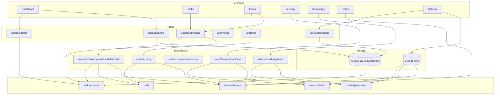

# Phase 5.0 · V4 页面架构与数据接口盘点

> 日期：2026-11-03 ｜ 版本 4.0.0-rc.1
> **本阶段只审计，未修改任何生产代码、CSS、配置、依赖或数据结构。**

---

## 1. 架构总览

```
DSH 宿主
└─ main slot / sidebar.panellist（index.tsx, PANEL_ID）
   └─ BoardPage
      ├─ Hero（V3 inline）
      ├─ ProjectBar（V3）
      ├─ ViewTabs（V4，本地 state，默认 classic）
      ├─ classic → .osb-grid：Overview / TaskList / FocusTimer / SessionLog / Stats（全 V3）
      └─ v4 → Dashboard（唯一 V4 页面）
```

- **V3 仍是默认页面**；V4 视图状态只存在 React state，刷新即回 classic。
- V3 的 7 个键走 `useLocalStore`（带跨标签冲突）；V4 的 7 个实体走 `lib/repo`（`localStorage` + 信封）。
- 存储 schema v4：`{ schemaVersion, data }`，读取兼容 V1/V2/V3；14 个 key，备份排除 `timer`、`aiRuns`。

---

## 2. 数据实体与接口

| 实体 | 数据来源 | 核心字段 | 主要读写接口 | 关联实体 |
| --- | --- | --- | --- | --- |
| Task | `STORAGE_KEYS.tasks` | `id,title,status,done,priority,projectId,dueAt,subtasks,sessionId,createdAt,updatedAt,completedAt,focusedMinutes` | `useBoardData`、`useLocalStore`、`actions.completeTask/reopenTask/deleteTask`、`lib/subtask` | Project、SessionLog、KnowledgeNode.taskIds |
| Project | `projects` | `id,name,color,archived,archivedAt,createdAt` | `useProject`、`useBoardData`、`scoped*`、`projectRanking` | Task、Log、Friction、Memory |
| SessionLog | `logs` | `id,at,kind,projectId,taskId,sessionId,title,minutes,tokens,source,edited` | `useBoardData`、`useSessionCapture`、`actions.addFocusLog/deleteLog/deleteLogs` | Task、Project、Daily |
| DailyAggregate | `daily` | `day,focusMinutes,tasksDone,sessions,friction` | `repo.readDaily/writeDaily`、`applyDailyDelta`、`syncDailyTasks`、`rebuildDay/rebuildDaily` | Logs、Tasks、Friction |
| ProjectMemory | `memory` | `projectId,intro,stack,architecture,done,progress,openIssues,resolvedIssues,decisions,nextSteps,version,updatedAt` | `repo`、`lib/memory.applyMemoryPatch/upsertMemory`、`actions.saveMemory` | Project、MemoryDraft、HistorySnapshot |
| MemoryDraft | `meta.memoryDrafts` | `projectId,at,source,patch,items[],rationale` | `buildDraftFromLogs`、`acceptDraft`、`actions.adoptDraft` | ProjectMemory、Logs |
| KnowledgeNode | `knowledge.nodes` | `id,title,summary,category,status,mastery,projectIds,taskIds,logIds,frictionIds,origin,nextReviewAt,reviewCount` | `repo`、`lib/knowledge.*`、`actions.deleteKnowledgeNode` | Project、Task、Log、Friction、Review |
| KnowledgeEdge | `knowledge.edges` | `id,fromId,toId,kind(related/prereq)` | `addEdge/removeEdge/removeNode/unlinkFrom/wouldCreateCycle` | Node |
| ReviewRecord | `reviews` | `id,nodeId,at,form,grade,note,nextAt,intervalDays` | `repo`、`schedule/createReview/pruneReviews/dueNodes/reviewStats` | KnowledgeNode |
| TimelineEvent | `timeline` | `id,at,type,projectId,refId,title,detail` | `repo`、`appendEvent/filterEvents/groupByDay`、`actions.*` | 所有业务动作 |
| HistorySnapshot | `history` | `id,projectId,at,label,counts,taskDoneIds,taskOpenIds,openFrictionIds,memoryVersion,memoryDigest` | `repo`、`buildHistorySnapshot/diffHistory/pruneSnapshots/needsAutoSnapshot` | Project、Task、Friction、Memory |
| BoardSettings | `settings` | `autoCapture,lastDurationMinutes,projectRules,monthlyGoal,activeProjectId,break*,context*，aiAutoDaily,aiTier,heatmapYear` | `useBoardSettings`、`writeSettings` | Project（activeProjectId） |
| BoardMeta | `meta` | `sessionTaskMap,memoryDrafts,upgradedFrom,lastWeeklyAt` | `useLocalStore`、`parseBackup` | Session/Task、MemoryDraft |
| TimerState | `timer` | `running,deadline,durationMinutes,remainingSeconds,phase,roundInCycle,focusMinutes,boundTaskId` | `useTimer` | Task、Focus |

**时间口径**：事件时间用 `readTime`（未来夹到 now+24h）；计划时间用 `readScheduleTime`/`clampDueAt`；`dayKey` 统一本地自然日。

---

## 3. Actions 盘点（`lib/actions.ts`）

| Action | 核心逻辑 | Daily | Timeline | History | 调用方 |
| --- | --- | --- | --- | --- | --- |
| `completeTask` | 幂等；改 done/completedAt；`syncDailyTasks` 绝对值；条件快照 | ✅ | ✅ `task.completed` | ✅ 条件 | `useBoardActions` ← TaskList.toggleTask |
| `reopenTask` | 幂等；清 completedAt；绝对值重算 | ✅ | ✅ `task.reopened` | ❌ | TaskList |
| `deleteTask` | 删任务、清日志 taskId、`unlinkFrom`、清 sessionTaskMap | ❌ | ❌ | ❌ | TaskList（确认删除） |
| `addFocusLog` | 同 id 幂等；`applyDailyDelta`；`focus.completed` | ✅ | ✅ | ❌ | FocusTimer |
| `addFriction` | 新增记录；Daily.friction +1 | ✅ | ✅ | ❌ | **无直接 UI 调用**（仅被 `addFrictionMerged` 复用） |
| `addFrictionMerged` | `mergeFriction` 后仅在新增时 +1 | ✅ | ✅ | ❌ | SessionLog 采集 |
| `resolveFriction` | 写 solution/resolveMs；不重复计次 | ❌ | ✅ | ❌ | FrictionLog |
| `deleteLog` / `deleteLogs` | 按天反向扣减 focusMinutes；幂等 | ✅ | ❌ | ❌ | SessionLog |
| `deleteKnowledgeNode` | `removeNode` + `pruneReviews` | ❌ | ❌ | ❌ | **无 UI 调用**（useBoardActions 暴露但无人用） |
| `saveMemory` | `applyMemoryPatch`；空补丁不涨版本；`memory.updated` | ❌ | ✅ | ❌ | **无调用方**（未进 useBoardActions） |
| `adoptDraft` | `acceptDraft` 只取勾选；清草稿；走 saveMemory | ❌ | ✅ | ❌ | **无调用方** |
| `buildImportSnapshot` | 导入后快照 | ❌ | ❌ | ✅ | DataPanel 导入成功 |

### 重点接口的真实接入

| 接口 | 真实状态 |
| --- | --- |
| `syncDailyTasks` | 被 `completeTask/reopenTask` 调用；TaskList 已接入 → **业务已通** |
| `rebuildDay` | **仍无调用**；只有测试与 `rebuildDaily` 定义 |
| `pruneReviews` | 被 `deleteKnowledgeNode` 调用，但该 action **无 UI 调用** → **未接入业务** |
| `appendEvent` | 被 complete/reopen/focus/friction 调用，TaskList/FocusTimer/FrictionLog 已接入 → **部分业务已通**；memory/knowledge 未接 |
| `buildHistorySnapshot` | `completeTask` 条件触发 + DataPanel 导入 → **部分接入** |
| `acceptDraft` | 只在 `adoptDraft` 内，`adoptDraft` 无调用方 → **未接入业务** |
| `applyMemoryPatch` | 只在 `saveMemory` 内，无调用方 → **未接入业务** |

---

## 4. Hooks 盘点

| Hook | 职责 | 关键点 |
| --- | --- | --- |
| `useBoardData` | 读 tasks/logs/friction/projects/meta，项目作用域派生 | 首次挂载做一次 `sanitizeAll`；返回 `all*` 与 `scoped*` |
| `useLocalStore` | V3 7 键的读写 + 跨标签冲突 | `dirty` 标记；`storage` 事件 + `ConflictHost`；卸载移除监听 |
| `useBoardActions` | 把 actions 接到存储 | 只暴露 10 个方法；**没有 saveMemory/adoptDraft**；`removeKnowledgeNode` 无调用者 |
| `useTimer` | 计时器状态机（start/pause/reset/phase） | 持久化 `timer`；休息不计专注；恢复未完成轮次 |
| `useSessionCapture` | Harness 事件采集 → 日志/阻碍 | `onFriction` 用 `addFrictionMerged`；卸载退订 |
| `useHarnessEvent` | 宿主事件订阅 | 依赖 `ctx`，错误降级 |
| `useSlashCommand` | `/board-*` 命令 | 与 `lib/commands` 共用解析 |
| `useProject` | 项目 CRUD / 模板 / 切换 | 归档过滤；`normalizeActiveId` |
| `useBoardSettings` | 设置读写 + 字段更新 | `activeProjectId` 持久化 |
| `useFrictionLog` | 阻碍列表/合并/解决（V3 本地逻辑） | 与 `actions` 存在职责重叠 |
| `useBackup` | 备份导出/导入（V3 面板） | 走 `parseBackup/applyImport` |
| `useStorageQuota` | 容量测量与预警 | 与 DataPanel 联动 |
| `useContextStats` | 上下文统计 | 只读派生 |

---

## 5. 七个页面映射

### Dashboard（READY，已完成）

真实数据：`board.tasks/logs`、`daily`、`timeline`、`computeBoardStats`、`countStreak`、`projectRanking(includeEmpty)`。
不重设计，只确认依赖；无写操作（除导航回调）。

### Tasks（PARTIAL）

已有：列表、新建、编辑、删除、完成/重开、优先级、状态、截止日、项目归属、子任务、筛选（all/active/done/overdue）。
缺口：
- 创建/编辑仍由 `TaskList` 直接 `board.setTasks`，**没有 action**，因此无 `task.created` 时间轴；
- 无搜索、无排序；
- V4 页面不存在，需复用 TaskList 逻辑或先抽 action，避免复制业务。

### Focus（READY）

已有：`useTimer`（start/pause/reset/phase/恢复）、`FocusTimer`、`actions.addFocusLog`（Daily + Timeline）、任务绑定、休息不计时。
缺口：V4 页面不存在；暂停/继续交互需按现有 timer 状态机重建，不得另写计时逻辑。

### Memory（PARTIAL）

已有：`ProjectMemory`、`MemoryDraft`、`buildDraftFromLogs`、`acceptDraft`、`applyMemoryPatch`、`saveMemory/adoptDraft`、repo、备份。
缺口：
- `saveMemory/adoptDraft` **没有暴露到 useBoardActions**，也没有 UI 调用；
- 版本只有 `version` 数字，**没有历史版本列表**；
- 草稿存 `meta.memoryDrafts`，无独立草稿页/确认流程；
- 时间轴只有 `memory.updated`，无逐条 diff。

### Knowledge（PARTIAL）

已有：节点/边/环检测/search/categories、`removeNode` 级联、`unlinkFrom`、复习 `schedule/createReview/dueNodes/reviewStats/pruneReviews`、repo。
缺口：
- 只有 `deleteKnowledgeNode` action，**没有 create/update/link/review 的 action**；
- `deleteKnowledgeNode` 无 UI 调用，`pruneReviews` 实际未接入；
- 图谱可视化数据足够（nodes+edges），但没有页面与交互。

### History（PARTIAL）

已有：`appendEvent`、`filterEvents/groupByDay`、`buildHistorySnapshot/diffHistory/pruneSnapshots`、repo。
缺口：
- 快照只在「任务完成且满足 needsAutoSnapshot」与「导入成功」时生成；
- 记忆/知识变更没有快照；`saveMemory` 未接 UI，`deleteKnowledgeNode` 无事件；
- 时间轴没有独立页面，V4 无 History。

### Settings（PARTIAL）

已有：`BoardSettings`（计时/目标/上下文/AI/热力图）、`useBoardSettings`、备份导入导出（V3 DataPanel）、`writeTransaction`。
缺口：
- V4 视图状态不持久化（刷新回 classic）；
- 主题由宿主控制，无插件内设置；
- 没有数据清理/重置 UI；
- 设置分散在 data panel / 计时器 / 统计卡。

---

## 6. 页面依赖图



**关键依赖**：
- Tasks 完成 → `completeTask` → Daily（绝对值）+ Timeline + 条件 History；
- Focus 完成 → `addFocusLog` → Logs + Daily + Timeline；
- Memory 修改 → `saveMemory` → Memory + Timeline（**当前未接 UI**）；
- Knowledge 删除 → `deleteKnowledgeNode` → Graph + Reviews（**当前未接 UI**）；
- Settings 导入 → `writeTransaction` 写 12 键 → 各页面重新读取；`timer/aiRuns` 不在导入范围。

---

## 7. 接口缺口与一致性风险

| # | 风险 | 证据 |
| --- | --- | --- |
| 1 | Memory 动作未接业务 | `saveMemory/adoptDraft` 在 actions，但 useBoardActions 未暴露、无调用方 |
| 2 | Knowledge 删除/复习清理未接业务 | `deleteKnowledgeNode` 暴露但无调用；`pruneReviews` 只在其中 |
| 3 | 任务创建/编辑绕过 actions | TaskList 直接 `board.setTasks`；无 `task.created` 事件 |
| 4 | 快照覆盖不全 | 仅任务完成（条件）+ 导入；Memory/Knowledge 变更无快照 |
| 5 | 时间轴事件不全 | 无 `task.created/deleted`；Knowledge 无事件；Memory 仅 saveMemory（未接） |
| 6 | 跨标签冲突只覆盖 V3 7 键 | `repo` 实体没有冲突提示；双标签写 memory/knowledge 会静默覆盖 |
| 7 | 日志 400 上限 vs streak/7 日点 | `countStreak` 与 Dashboard 活跃点依赖 logs，老记录裁剪后会缩短 |
| 8 | `rebuildDay` 无调用 | 增量 Daily 非幂等；重试路径未用幂等入口 |
| 9 | V4 视图状态不持久 | `useState` 默认 classic，刷新回落 |
| 10 | 项目列表只展示前 3 | 计数是全量，但列表截断 |
| 11 | Settings 分散 | 主题在宿主、视图在组件 state、备份在 V3 panel |
| 12 | `useFrictionLog` 与 actions 职责重叠 | 两套阻碍解决/合并路径，未来需统一以避免口径分叉 |

---

## 8. 状态表

| 页面 | 状态 | 依据 |
| --- | --- | --- |
| Dashboard | **READY** | 已实现，数据全部真实 |
| Tasks | **PARTIAL** | 数据模型与 V3 UI 完整；缺 create/update action、搜索/排序、V4 页面 |
| Focus | **READY** | useTimer + addFocusLog + 任务绑定足够；只缺 V4 页面 |
| Memory | **PARTIAL** | 数据/动作存在，但无 hook 暴露、无历史版本、无 UI |
| Knowledge | **PARTIAL** | 图谱/复习算法完整；缺 CRUD/link/review actions 与 UI，prune 未接 |
| History | **PARTIAL** | Timeline/快照函数完整；快照触发点与事件覆盖不足 |
| Settings | **PARTIAL** | 设置/备份存在；视图持久化、清理、V4 页面缺失 |

> 没有页面是 BLOCKED：数据层都具备，缺的是 action 编排与 UI，而不是底层能力。

---

## 9. 推荐开发顺序

1. **Tasks** —— 最基础，完成/删除已走 actions；先补 `createTask/updateTask` + `task.created`，再建 V4 页面。风险低、复用最多。
2. **Focus** —— 依赖 Tasks 的绑定；`useTimer` 与 `addFocusLog` 已就绪，页面主要是布局与状态呈现。
3. **History** —— 依赖 Tasks/Focus 产生的事件；先补快照触发点与事件覆盖，再做筛选/日期视图。
4. **Memory** —— 需要先把 `saveMemory/adoptDraft` 接进 useBoardActions，并决定版本历史存哪（当前只有 version 数字）。
5. **Knowledge** —— 需要补节点 CRUD、关系、复习的 action 编排；UI 复杂度最高（图谱可视化）。
6. **Settings** —— 跨页面，最后做；先明确视图持久化、清理范围、备份入口归属。

理由：按「依赖上游 → 下游」与「action 缺口大小」排序；Knowledge 放后是因为要先补 4 类 mutation，且图谱交互成本最高。

---

## 10. 建议的 Phase 5.1 范围

**只做 Tasks 的 V4 页面 + 它必需的最小 action 补齐**：

1. `actions.createTask` / `actions.updateTask`（含 `task.created` 事件、项目归属校验）；
2. `useBoardActions` 暴露两者；
3. V4 Tasks 页面：列表、新建/编辑、完成/重开、删除、优先级、截止日、项目筛选；
4. 测试：创建→完成→重开→删除 的 Daily/Timeline 一致性；V3 TaskList 不回归；
5. 不碰 Memory/Knowledge/History/Settings。

---

## 11. 审计结论

- V3 仍完整、默认；V4 只有 Dashboard，但数据层已经覆盖七个页面的大部分实体。
- 真正的缺口不是「数据表」，而是 **action 编排与 UI 接入**：Memory 两个动作、Knowledge 删除/复习清理、任务创建/编辑都还没有业务调用。
- 任何 V4 页面开发前，先把对应 action 接通并补事件/快照，否则会重复出现「功能有、数据不动」的问题。
